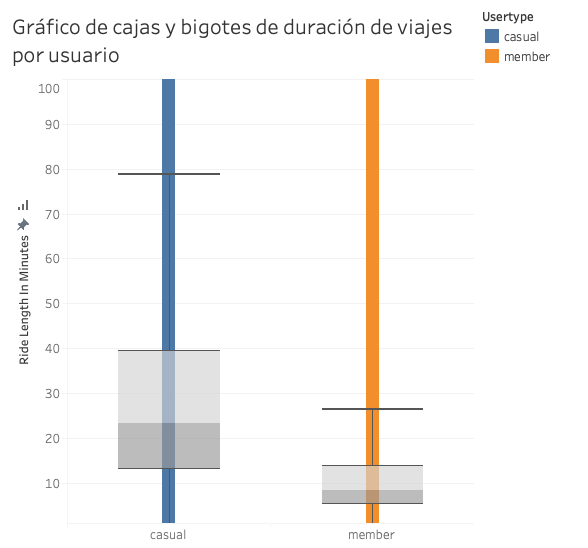
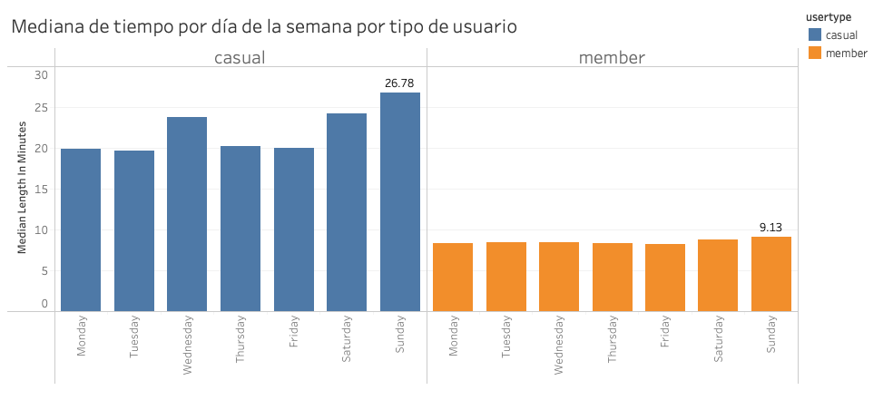
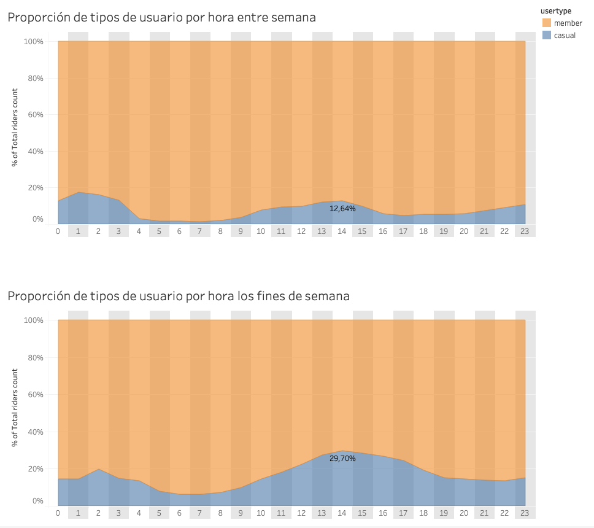
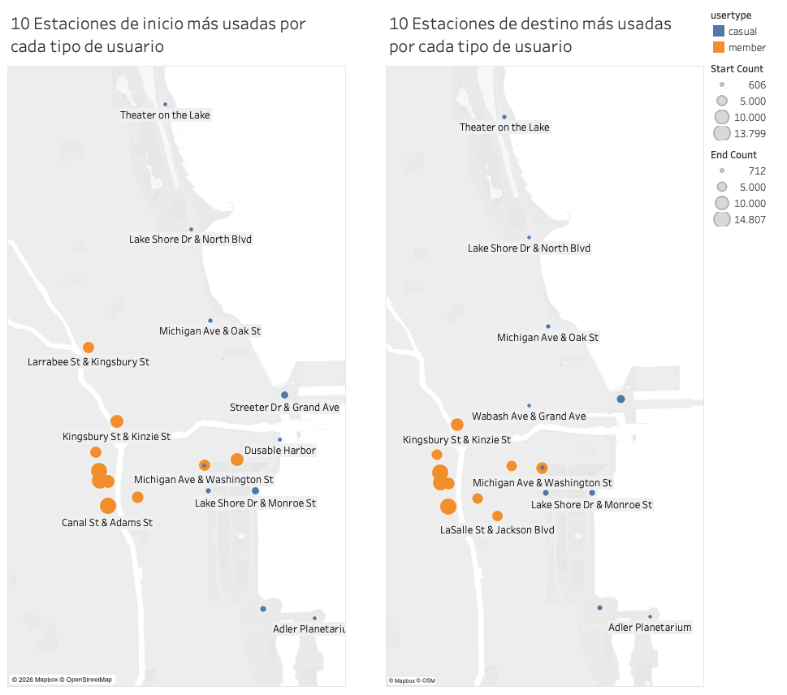

# Cyclistic: caso de estudio 
**Análisis de datos de uso del servicio de bicicletas urbanas de Chicago para su uso en marketing**

## Brief
El propósito de este proyecto es implementar los conocimientos adquiridos en la [Certificación de Google y Coursera Analista de Datos Profesional](https://www.coursera.org/programs/crece-con-google-2026-fundacion-compromiso-05nl2/specializations/google-data-analytics). Se abordó según los lineamientos del ejercicio y se buscaron rasgos de uso diferenciadores del segmento de usuarios casuales, frente a los miembros anuales. Cabe destacar que el segmento de usuarios de interés es 11 veces menor a su contraparte, con lo cual, me centré en buscar tendencias dentro del propio segmento y en rasgos que al compararlo con el segmento de miembros, los casuales lo superaran, los cuales fueron el tiempo mediano de uso y la proporción de los viajes redondos. 
	
### [Presentación de resultados (PDF)](https://github.com/pixelciosa/cyclistic/blob/main/Cyclistic.pdf)

## Hallazgos clave

**1. El promedio engaña: la mediana muestra el comportamiento real.**
Unos pocos viajes de varios días inflaban el promedio casual a 89 min. La mediana es de 23 min, unas 2,7 veces la de los miembros (8 min).

**2. Los casuales pedalean más tiempo y los fines de semana.**
Domingo (26,8 min) y sábado (24,2 min) son los días con viajes casuales más largos.

**3. Los sábados y domingos, entre las 12 y las 17 h, los casuales llegan a ser ~30% de los viajes.**

**4. Ocio en la costa contra traslados en el centro.**
Las estaciones casuales rodean el lago (Streeter Dr & Grand Ave, Lake Shore Dr & Monroe St). Las de los miembros se concentran cerca de las terminales de tren.

## Bitácora del proyecto
**Tarea de negocio:** Diferenciar los miembros anuales de los casuales según el uso que le dan a las bicicletas. Buscamos características que puedan usarse en estrategias de medios digitales para conseguir que los usuarios casuales prefieran ser miembros anuales.

**Métricas:** duración mediana de viaje, proporción de viajes redondos, proporción de uso entre semana y fines de semana, distribución de tipos de usuario según horarios, días y meses de uso, principales estaciones de inicio y final del viaje.

**Recomendaciones:**

* Las acciones de marketing podrían enfocarse en la zona geográfica de la costa que es donde se encuentran las 10 estaciones más utilizadas, con mayor intensidad en Streeter Dr & Grand Ave y Lake Shore Dr & Monroe.  
* Los viajes casuales hacen recorridos de duración 2,7 veces más larga, en la costa y los fines de semana; se puede valorar ofrecer una membresía de fin de semana o estacional para usuarios centrados en el uso por ocio.    
* La franja semanal con mayor cantidad de viajes casuales es entre las 12 y la 17 horas del sábado y domingo, se recomienda tenerlo en cuenta en caso de planificar desplegar promotores y activar la campaña de membresía.  

**Fuentes de datos utilizadas:** [Link](https://divvy-tripdata.s3.amazonaws.com/index.html)  
Los datos son publicados por la empresa que los recopila con licencia de uso público y limitado. No cuentan con ningún tipo de garantía, se entregan tal cual están, en archivos .zip. Los datos disponibles son desde 2013 y varía el alcance temporal de cada archivo a través del tiempo. El 2013 está en un solo archivo, del 2014 al 2017 inclusive, están en archivos semestrales (2 trimestres por archivo), del 2018 al primer trimestre del 2020 está en archivos trimestrales y desde abril 2020 en adelante hay un archivo por cada mes. Se dispuso poner el foco en el Q1 del 2019 y 2020\.

**Herramientas elegidas:** 

* Google Spreadsheets para exploración y limpieza de datasets por separado,   
* PostgreSQL, Docker, Python/pandas, Jupyter Notebook y DBeaver para trabajar con el dataset unificado.   
* Tableau para visualizaciones, [link a Tableau Public](https\://public.tableau.com/app/profile/adriana.villalobos4932/viz/Cyclistic2\_17945185382940/Dashboard4)

**Procesamiento de datos:** 

1. Líneas vacías: en Cyclistic\_Trips\_2020\_Q1 se detectaron 2 y se borraron (líneas 426889 y 426890\) y en Cyclistic\_Trips\_2019\_Q1 también se detectaron 2 y se borraron (líneas 365071 y 365072\)  
2. Columnas comunes: los datasets tienen columnas con distintos datos y algunos datos en común aunque el nombre de las columnas no es igual. De modo que tenemos:

   

   1. Columnas en común con nombres diferentes (2019 \| 2020):  
      * trip\_id \| ride\_id  
        * valores: numéricos \| alfanuméricos  
      * start\_time \| started\_at  
      * end\_time \| ended\_at  
      * from\_station\_id \| start\_station\_id  
      * from\_station\_name \| start\_station\_name  
      * to\_station\_id \| ​​end\_station\_id  
      * to\_station\_name \| end\_station\_name  
      * usertype \| member\_casual  
        * valores: subscriber \- customer \| member \- casual  
   2. Columnas distintas  
      * 2019:   
        * bikeid  
        * tripduration (en cantidad de segundos)  
        * gender  
        * birthyear  
      * 2020:   
        * rideable\_type   
        * start\_lat  
        * start\_lng  
        * end\_lat  
        * end\_lng  
3. Se manipularon los datasets para contener solo las columnas comunes y los nombres de columna y valores correspondientes a 2020 por ser más actuales.  
4. Se calculó el tiempo del viaje en la columna ride\_length usando el formato hh:mm:ss  
5. Se sumó una columna para el número de la semana en que se empezó el viaje. (1 \= domingo y 7= sábado)  
6. Se planea validar si los viajes que se hacen en Headquarters que se deberían sacar de la muestra, ya que en el dataset de 2020, hay 3765 registros que empiezan y terminan en la estación llamada “HQ QR”   
   1. 3761 valores son de menos de un minuto y 4 de más de un minuto.  
   2. hay duraciones negativas  
7. En el motor de SQL (DBeaver) la columna ride\_length se creó de TYPE INTERVAL por tener formato hh:mm:ss y tener valores mayores de 24 horas en algunos casos.  
8. Se hizo un UNION ALL de los 2 datasets y los ride\_id pasaron a ser TYPE VARCHAR(255)  
9. Se confirma que los viajes que inician en “HQ QR” son datos de prueba, al igual que los viajes con duración negativa, de modo que se excluyen esos datos  
10. Se valida que la unidad de tiempo deseable para el ride\_length es en cantidad de segundos con formato de número con decimales

**Análisis de datos:**

| Métrica | Casual | Member |
| :---- | :---- | :---- |
| Distribución de la duración promedio de viaje | **El \~88% de los viajes son de menos de una hora**, y el \~11% de más de una hora. Tendencia que se mantiene estable entre el Q1 del 2019 y el Q1 del 2020\.  | El 99,7% de los viajes son de menos de una hora, y el 0,23% de más de una hora.  Tendencia que se mantiene estable entre el Q1 del 2019 y el Q1 del 2020\.  |
| Duración promedio del viaje vs. mediana de viaje | Se observó que usar el promedio como métrica de duración ocultaba una pequeña cantidad de datos extremos que elevaban el promedio 3,9 veces por encima de la mediana, por lo que se usó la métrica del 2do cuartil, es decir la mediana, para las comparaciones. |  |
| Mediana general de duración de viaje | **23 minutos**, es decir, 2,7 veces más que los miembros. | 8 minutos |
| Mediana de duración de viaje según el día de la semana | **La mediana de tiempo más alta es los domingos** con 26,78 minutos, **seguido del sábado** con 24,23 **y el miércoles** 23,78 minutos. Los demás días se mantiene por debajo de 20,5 minutos  | Es muy estable, aunque tiende a aumentar algunos segundos el fin de semana  |
| Mediana de duración de viaje según el mes | El mes con **mayor duración mediana de viajes es marzo** y el de menor duración mediana es enero, posiblemente relacionado con las temperaturas que en enero tienden a ser las más bajas del invierno e incluso puede haber nieve. | Varía menos de 1 minuto entre los meses del Q1 |
| Proporción de viajes redondos | **14% de los viajes casuales empieza y termina en la misma estación** | 2% de los viajes de miembros empieza y termina en la misma estación |
| Proporción de uso entre semana y fines de semana | La cantidad de viajes casuales **aumenta el fin de semana siendo el Domingo el día más popular** con \+18.6 mil viajes casuales. El día menos popular es el Lunes con un total de \+5.5 mil viajes casuales.  | La cantidad de viajes de miembros disminuye el fin de semana siendo el Sábado el día menos popular con \+59.4 mil viajes de miembros. El día más popular es el Martes con un total de \+127.9 mil viajes de miembros.  |
| Distribución de tipos de usuario según el mes | **Marzo** es el mes con mayor cantidad de viajes del Q1, llegando a sobrepasar a la suma de Enero y Febrero por \~13 mil viajes. | Marzo es el mes con mayor cantidad de viajes y febrero el más bajo, con una diferencia entre ellos de \~45 mil viajes. |
| Distribución de tipos de usuario según horarios y días de uso | **La franja preferida por los viajes casuales es durante el día los fines de semana** con \+14 mil viajes promedio cada día. | La franja preferida por los viajes de miembros es durante la hora pico los días entre semana con \+71 mil viajes cada día. |
| Principales estaciones de inicio y final del viaje. | **Las estaciones más usadas son las que se ubican rodeando la costa, desde el Teatro del Lago hasta el Planetario Adler.**  | Las estaciones más usadas son las que se ubican desde Larrabee St & Kingsbury St. hasta Canal St & Adams St. con concentración en la zona de la terminal de tren. |
| Principales estaciones de inicio del viaje. | **Destacan Streeter Dr & Grand Ave** y Lake Shore Dr & Monroe St. con \+2.7 mil viajes casuales. | Destacan Canal St & Adams St y Clinton St & Madison St con \+13.3 mil viajes de miembros |
| Principales estaciones de final del viaje. | **También destacan Streeter Dr & Grand Ave, con mil devoluciones más que retiros** y Lake Shore Dr & Monroe St. con 2.1 mil viajes casuales finalizando el recorrido. | Al igual que en el retiro de bicicletas, destacan Canal St & Adams St y Clinton St & Madison St con \+14.5 mil viajes de miembros finalizados. |
| Principales estaciones de inicio y final del viaje. | **En viajes redondos la estación más elegida para viajes casuales es Lake Shore Dr & Monroe St** con \+700 viajes. Seguido por distintas estaciones que bordean o están cerca de la costa | En viajes redondos las 10 estaciones más elegidas entre los miembros rondan los 110 viajes y se ubican desde California Ave & Montrose Ave al norte hasta Shore Dr & 55th St al sur con concentración en la zona media entre el río Chicago y su desembocadura en el lago Michigan. La que más viajes tiene es Wabash Ave & Grand Av con un total de 162 viajes redondos de miembros. |

**Recomendaciones para futuros análisis:**

* Considerar incluir en los datos brutos futuros el id de usuario para poder hacer un análisis más centrado en el comportamiento de los usuarios en el tiempo lo que permitiría incluir en futuros análisis, por ejemplo, la frecuencia de viajes.  
* Valorar profundizar en los datos de usuarios casuales con viajes de más de un día que distorsiona mucho el promedio de tiempo.
